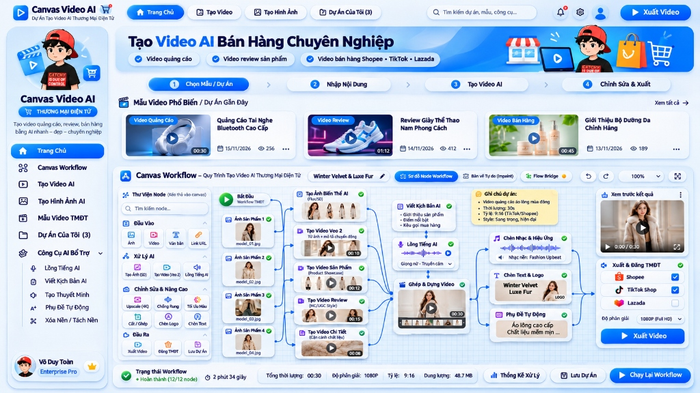
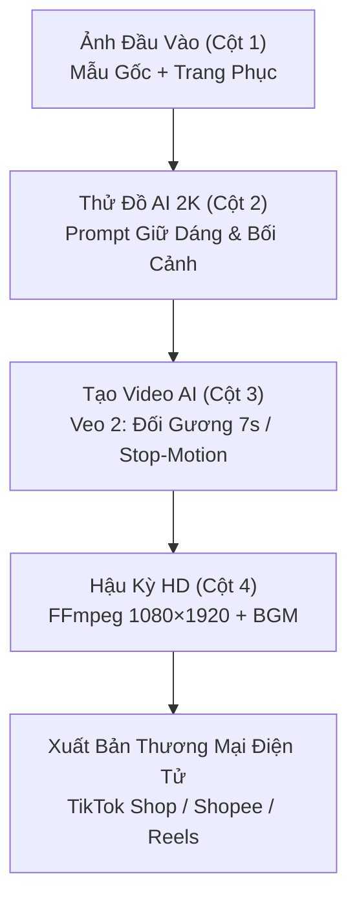

# AI Canvas Studio — Canvas Video AI 🎬✨
> **Quy Trình Tạo Video & Lookbook AI Thương Mại Điện Tử Chuyên Nghiệp (Google Flow, Imagen 3 & Veo 2)**

<p align="center">
  
</p>

<p align="center">
  
  
  
  
  
</p>

---

## 🌟 Giới Thiệu (Overview)

**AI Canvas Studio (Canvas Video AI)** là nền tảng canvas đồ họa trực quan kết hợp tự động hóa đa nhánh để sản xuất ảnh Lookbook thời trang 2K và video thương mại điện tử chuyên nghiệp (phục vụ TikTok Shop, Shopee, Lazada, Reels). 

Hệ thống tích hợp trực tiếp với **Google Flow (Imagen 3 & Veo 2)** thông qua **Chrome Extension Bridge v4.2.1**, cho phép đồng bộ hóa dữ liệu hai chiều, tự động nạp ảnh tham chiếu, dán câu lệnh prompt chuẩn mực và trích xuất kết quả về bàn vẽ theo thời gian thực mà không làm nghẽn luồng làm việc.

---

## 🚀 Tính Năng Nổi Bật (Key Features)

- **🎨 Bàn Vẽ Node Workflow (120 FPS):** Thiết kế sơ đồ pipeline kéo thả trực quan theo từng nhánh: Ảnh Người Mẫu + Trang Phục ➔ Thử Đồ AI 2K ➔ Render Video 7s/15s ➔ Hậu kỳ Nâng nét HD.
- **⚡ Cầu Nối Tự Động Hóa Google Flow (Extension v4.2.1):** 
  - Tự động nạp tuần tự `@Image 1` (Mẫu) và `@Image 2` (Trang phục) bằng đa phương thức (Clipboard + Drag & Drop).
  - Tự động đợi đồng bộ hoàn tất tải ảnh lên mới bấm nút Gửi (chống bấm nhầm nút Setting/Tune slider).
  - Trích xuất ảnh/video kết quả với bộ lọc tọa độ và fingerprint loại trừ tuyệt đối ảnh đầu vào.
- **👗 Hỗ Trợ Dự Án Chuẩn `da-ai-canvas` v2:**
  - **Lookbook & Video Đối Gương 7s:** Thử đồ AI 2K 9:16 giữ nguyên tư thế & căn phòng đối gương ➔ Video chuyển động tự nhiên 7 giây (Nhánh Phim 35mm & Nhánh Phố Hàn).
  - **Winter Velvet & Luxe Fur 15s:** Thử đồ 4 bộ lông thú 3 góc độ ➔ Video Stop-Motion 90° Top-Down Sofa ➔ Upscale 1080×1920 kèm BGM.
- **🔄 Đồng Bộ 2 Kênh (Dual-Channel Relay):** Tự động chuyển đổi giữa `Direct Window Bridge` và `Backend Relay` đảm bảo không bao giờ bị treo trạng thái "Đang chờ".

---

## 🏗️ Cấu Trúc Dự Án (Project Structure)

```text
ai-canvas-studio/
├── assets/                       # Ảnh banner, tài liệu minh họa (README)
│   └── ai-canvas-studio-preview.jpg
├── client/                       # Giao diện Web Canvas (Vite + React 18 + TailwindCSS)
│   ├── src/
│   │   ├── components/           # WorkflowNodeCanvas, InfiniteCanvas, PromptDock...
│   │   ├── services/             # flowBridge.js, api.js
│   │   ├── store/                # Zustand state management
│   │   └── utils/                # daCanvasConverter.js (bộ chuyển đổi JSON v2)
│   └── vite.config.js
├── extension/                    # Chrome Extension Automation Bridge (Manifest V3)
│   ├── background.js             # Service worker điều phối hàng đợi tác vụ Google Flow
│   ├── content.js                # Tự động hóa DOM trên labs.google / flow.google.com
│   ├── canvas-bridge.js          # Nhúng vào Web Canvas để nhận diện extension
│   └── manifest.json             # Manifest v4.2.1
├── server/                       # Backend Express API Server (Port 5001)
│   ├── data/projects.json        # Kho lưu trữ cấu hình dự án mẫu UTF-8
│   └── src/                      # API định tuyến & xử lý hậu kỳ (Upscale, BGM)
└── README.md
```

---

## 🛠️ Hướng Dẫn Cài Đặt & Chạy (Quick Start)

### 1. Yêu Cầu Môi Trường
- **Node.js** >= 18.x
- **Google Chrome** (đã đăng nhập tài khoản có quyền truy cập [Google Flow](https://flow.google.com/))

### 2. Khởi Động Server & Client
```bash
# Khởi động Backend (Port 5001)
npm start --prefix server

# Khởi động Frontend Client (Port 5174 hoặc 5173)
npm run dev --prefix client
```

* Truy cập bàn vẽ tại: **`http://localhost:5174/`**
* Kiểm tra trạng thái Backend: **`http://localhost:5001/health`**

### 3. Cài Đặt Chrome Extension Bridge
1. Mở Chrome và truy cập đường dẫn: `chrome://extensions/`
2. Bật chế độ **Developer mode (Chế độ dành cho nhà phát triển)** ở góc trên bên phải.
3. Nhấn **Load unpacked (Tải tiện ích đã giải nén)** và trỏ vào thư mục `extension/` của dự án.
4. Mở tab [Google Flow](https://flow.google.com/), bạn sẽ thấy huy hiệu xanh góc trái dưới:
   `🟢 AI Canvas Bridge v4.2: Đã kết nối`.

---

## 📋 Quy Trình Thực Thi Một Workflow Mẫu



---

## 👤 Tác Giả (Author)

* **Võ Duy Toàn** ([@Joinney](https://github.com/Joinney))
* **Email:** voduyduydlk@gmail.com
* **Repository:** [https://github.com/Joinney/ai-canvas-studio](https://github.com/Joinney/ai-canvas-studio)

---

## 📄 Giấy Phép (License)
Dự án được phát hành theo giấy phép [MIT License](LICENSE).
